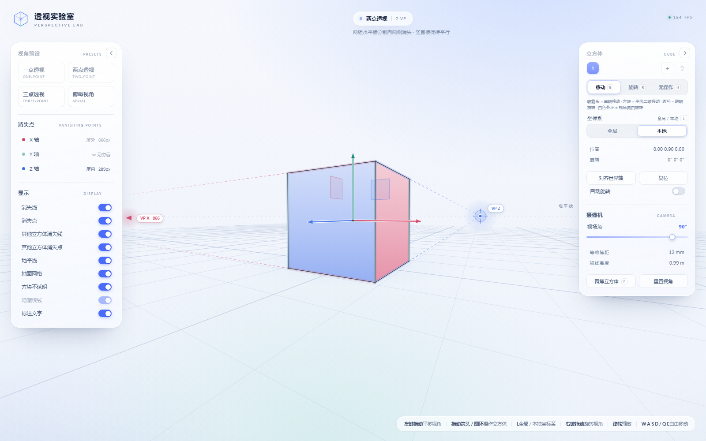
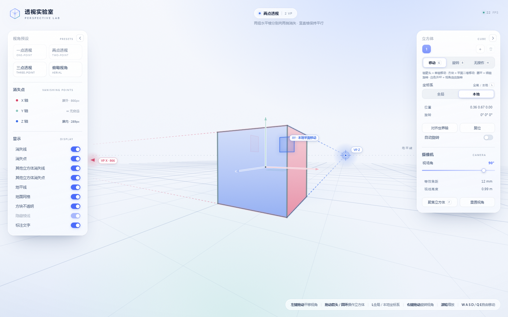
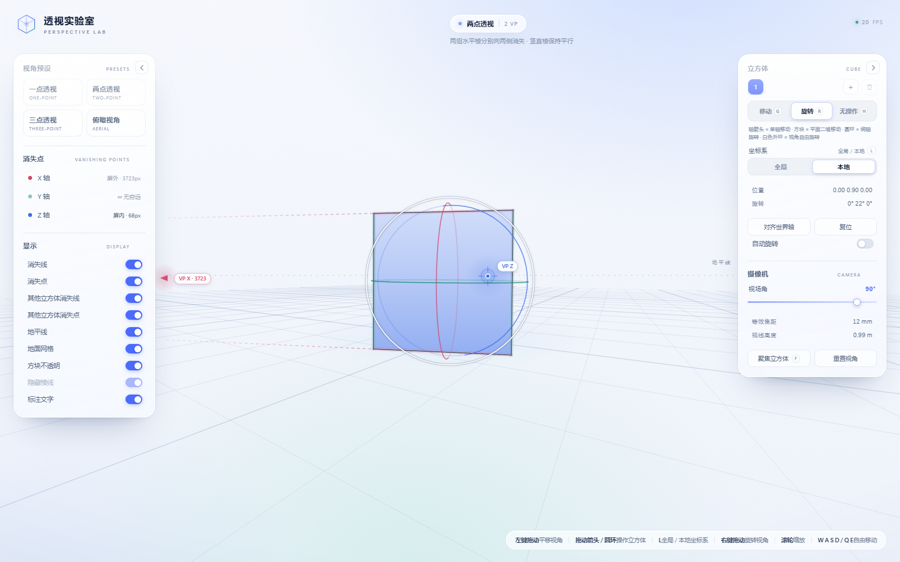
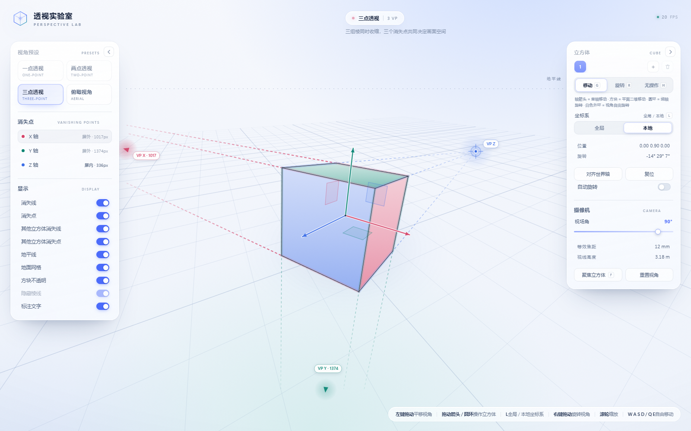
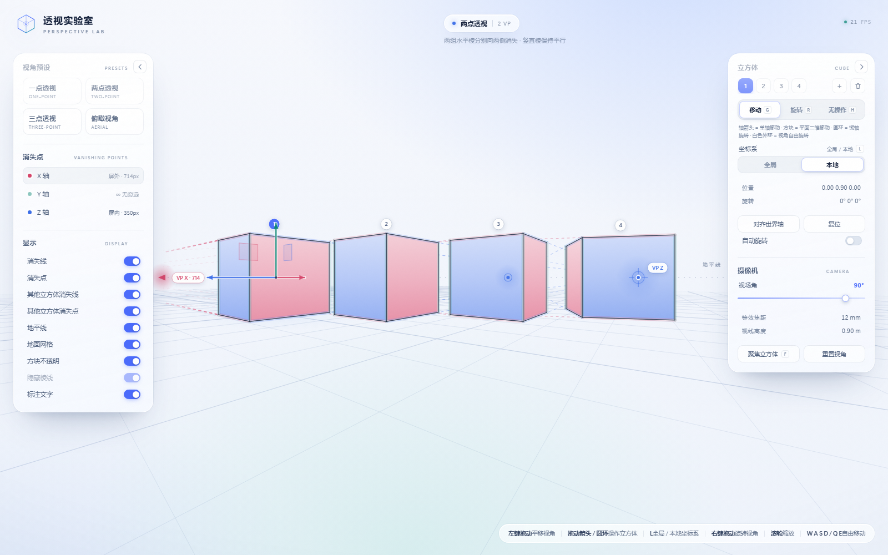

# 透视实验室 · Perspective Lab

一个用于理解绘画透视的交互式 3D 小工具：自由移动/旋转摄像机，观察立方体的三组棱如何汇聚成消失线，并从画面中实时推导出消失点。



## 快速开始

直接双击打开 **`index.html`** 即可（无需安装、无需联网、无任何第三方依赖）。

- 分享版单文件：`perspective-lab.html`（由 `tools/build-standalone.mjs` 内联 CSS/JS 生成，同样可双击打开）
- 推荐浏览器：Chrome / Edge / Safari / Firefox 近两年版本

## 操作方式

| 操作 | 作用 |
| --- | --- |
| 左键拖动 | 平移摄像机（观察目标） |
| 右键拖动 | 环绕旋转摄像机 |
| 中键拖动 | 平移摄像机 |
| 触屏单指拖动 | 旋转摄像机 |
| 滚轮 / 双指捏合 | 推拉镜头（改变距离） |
| `W` `A` `S` `D` | 沿视线方向自由平移 |
| `Q` / `E` | 垂直升降 |
| `Shift` + 移动 | 加速移动 |
| 拖动箭头 | 沿 X / Y / Z 轴移动立方体（轴正对镜头时显示为「深度环」，上下拖动） |
| 拖动平面方块 | 在 XY / YZ / ZX 平面内二维移动立方体 |
| 拖动圆环 | 绕 X / Y / Z 轴旋转立方体 |
| 拖动中心白色外环 | 绕摄像机视角方向自由旋转（水平 / 垂直分别对应摄像机 up / right 轴） |
| 点击立方体 / 面板编号 | 选中要编辑的立方体（消失点与消失线跟随选中对象） |
| 面板 `＋` / 删除按钮 | 添加 / 删除立方体（`Delete` 可删除选中立方体） |
| `G` / `R` / `H` | 切换「移动 / 旋转 / 无操作」模式（无操作会隐藏全部变换手柄） |
| `L` | 切换变换坐标系：全局（世界轴）/ 本地（立方体自身轴） |
| `F` / 双击画布 | 把摄像机聚焦到立方体 |
| `1` `2` `3` `4` | 一点 / 两点 / 三点 / 俯瞰预设 |
| 空格 | 立方体自动旋转 |
| 拖动时按 `Shift` | 位移吸附 0.25 / 旋转吸附 15° |
| 悬停「消失点」列表 | 高亮该轴对应的消失线；点击可固定高亮 |

右侧面板可查看立方体的位置、旋转角度、镜头视场角（等效焦距）与视线高度；左侧面板可切换显示项与视角预设。

显示设置中的「方块不透明」默认开启，关闭后立方体变为半透明玻璃，可以看到隐藏棱线与内部结构；不透明模式下隐藏棱线开关会自动置灰。

界面底部的操作提示固定在**右下角**；左右两个面板右上角的箭头可以**折叠 / 展开**，折叠后绘图区会自动扩大，消失点在画面边缘的指示位置也随之调整。

**多立方体**：通过面板 `＋` 添加立方体，新立方体会自动对齐世界轴并被选中；点击立方体或面板编号即可切换选中对象。消失点与消失线始终针对**当前选中的立方体**推导（切换选中对象即可对比不同立方体的透视），多个立方体还会在顶部显示编号角标。显示设置中提供两个**独立开关**：「其他立方体消失线」和「其他立方体消失点」，可以分别为未选中立方体开启消失线与消失点（更淡、无标签；相同朝向的立方体共用同一组消失点会自动去重）。

**变换手柄**：移动模式包含三根轴箭头、三个平面二维移动方块（XY / YZ / ZX）与正对镜头时退化的「深度环」；旋转模式包含三个轴向圆环，以及最外层的一个白色自由旋转环——拖动它时水平方向绕摄像机 up 轴、垂直方向绕摄像机 right 轴旋转，实现与视角相关的二维旋转。模式切到「无操作」（`H`）可隐藏所有控制柄，只保留场景观察。





默认状态：**90° 视场角**、立方体**与世界轴对齐**、变换手柄使用**本地坐标系**。视角预设采用**相对值**：只把摄像机移动到立方体本地坐标系中的固定方向并注视立方体，不会修改立方体的位置或旋转；视场角保持不变，因此立方体被移动或旋转后预设依然适用。

变换手柄支持两种坐标系：**全局**（沿世界 X / Y / Z 轴）与**本地**（沿立方体自身的三个轴向）。切换后箭头与旋转圆环会立即跟随立方体姿态，旋转始终围绕所选坐标系中的轴进行。





## 它如何判断「该不该标消失点」

消失点不是画出来的装饰，而是每帧由摄像机参数推导出来的：

1. 取立方体自身的三个轴向 `d`（它会随立方体旋转而变化）；
2. 将 `d` 变换到摄像机空间得到 `(dx, dy, dz)`；
3. 消失点屏幕坐标 = `画面中心 + f · (dx / dz, −dy / dz)`（`f` 为像素焦距）；
4. **当 `|dz| < 0.105`（轴向与画面夹角小于约 6°）时，该方向的棱在画面中保持平行，视为「消失于无穷远」，不标注消失点，也不画它的消失线**；
5. 每个有效消失点只从对应的 4 条棱延伸出消失线：线条从离消失点较远的端点出发，穿过棱本身延伸到消失点。屏幕外的消失点会在绘图区边缘显示方向箭头和距离；
6. 地平线由「过摄像机且平行于地面的平面」投影得到，水平视线时恰好穿过画面中心。

因此：

- 正对立方体（一点透视）→ 只有深度方向 1 个消失点；
- 摄像机与立方体大致同高、立方体绕竖直轴旋转（两点透视）→ 左右 2 个消失点，竖直棱保持平行；
- 俯视或仰视再加旋转（三点透视）→ 3 个消失点全部出现。

转动摄像机或拖动立方体时，消失线、消失点、地平线、透视类型标签都会实时更新。

## 视觉与交互设计

- 明亮「绘图纸」风格：浅色渐变底、白色玻璃面板、柔和投影与细腻描边，长时间观察不刺眼；
- 轴色编码（X 玫红 / Y 青绿 / Z 靛蓝）贯穿立方体棱线、消失线、消失点与面板标签；
- 立方体默认使用**不透明浅色材质**（浅色轴色渐变 + 深色棱线），显示设置中关闭「方块不透明」可切换为半透明玻璃材质；不强调顶点标记，保持画面干净；
- 消失线使用带渐隐的彩色虚线，离立方体越远越淡；屏幕外消失点在绘图区边缘给出方向与距离；
- 摄像机运动带指数阻尼，拖动跟手且不生硬；视角预设与立方体复位使用缓动插值；
- 左右面板支持折叠（折叠后绘图区自动扩大，并在侧边保留展开标签）；底部操作提示固定在右下角；
- 支持添加多个立方体，每个立方体带编号角标；未选中立方体的消失线 / 消失点分别有独立显示开关；
- 变换手柄支持平面二维移动、轴向旋转与视角相关的二维自由旋转（最外层白色环）；「无操作」模式可隐藏全部手柄；
- 所有绘制基于同一个实时透视投影矩阵，窗口缩放 / 高 DPI 屏幕自动适配；移动端提供可展开的控制面板。

## 技术实现

- 纯前端、零依赖：HTML + CSS + 原生 Canvas 2D 矢量渲染；
- 自实现三维数学库：向量、四元数（含 slerp / 欧拉角转换）、透视投影、近平面裁剪、线段矩形裁剪、射线-直线/射线-平面求交；
- 3D 拾取：将世界空间线段、圆环投影到屏幕后用「点到线段距离」做手柄命中检测；旋转拖拽用「射线与轴垂直平面求交」计算绕轴角度；
- 主循环使用 `requestAnimationFrame`，摄像机做指数平滑，HUD 以约 10Hz 刷新，低开销。

### 目录

```
perspective-lab/
├─ index.html                 入口
├─ perspective-lab.html       构建后的单文件版
├─ css/style.css              视觉系统
├─ js/core.js                 数学 / 摄像机 / 投影 / 裁剪
├─ js/scene.js                立方体模型、消失点/消失线、变换手柄
├─ js/render.js               Canvas 2D 渲染
├─ js/app.js                  状态、交互、预设动画、HUD
├─ tests/core.test.js         数学与几何自测（Node）
├─ tools/capture.mjs          无头 Chrome 截图
├─ tools/verify.mjs           无头 Chrome 交互验收
└─ tools/build-standalone.mjs 生成单文件版
```

### 自测

```bash
node tests/core.test.js     # 50 项投影 / 消失点 / 地平线 / 可见性断言
node tools/verify.mjs       # 68 项无头浏览器交互验收（需要本机 Chrome）
node tools/capture.mjs      # 生成 shots/ 下的场景截图
```

`tools/verify.mjs` 会真实模拟鼠标拖拽、滚轮、键盘和面板点击，并断言摄像机、立方体、消失点状态是否正确。

## 学习建议

1. 先点「一点透视」，左右拖动摄像机，观察画面里唯一的消失点如何随视线移动；
2. 点「两点透视」，注意竖直棱始终保持平行，而两组水平棱分别收向左右边缘外的消失点；
3. 切换到「俯瞰视角」，三组棱同时收缩，三个消失点出现——这就是三点透视；
4. 打开「自动旋转」，看消失点如何一边移动一边保持几何关系；
5. 调节视场角，感受广角镜头下更强烈的透视收缩。
